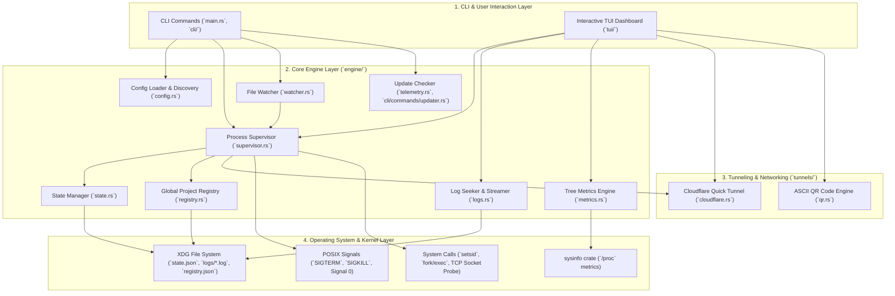
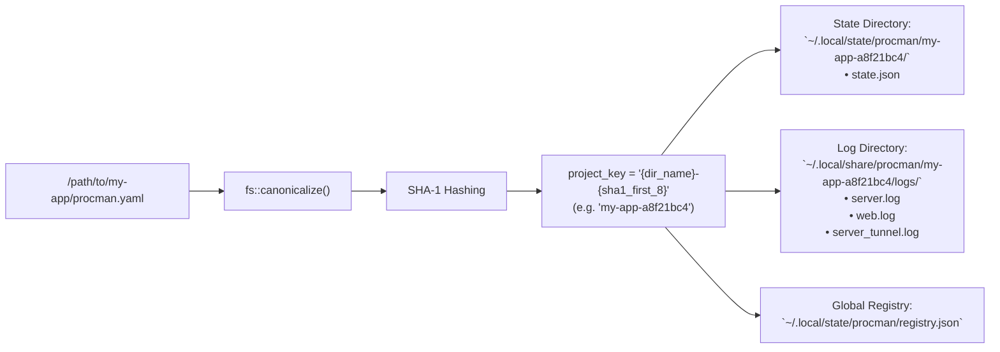
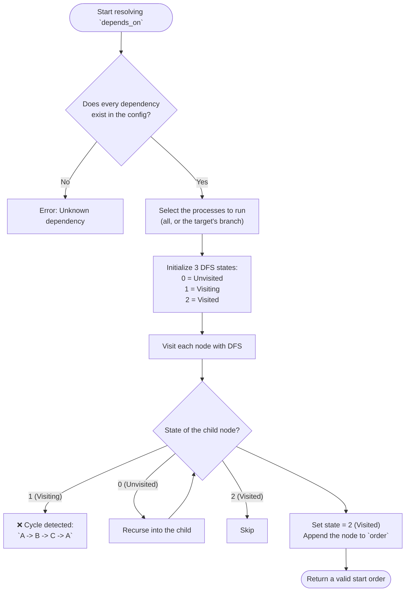
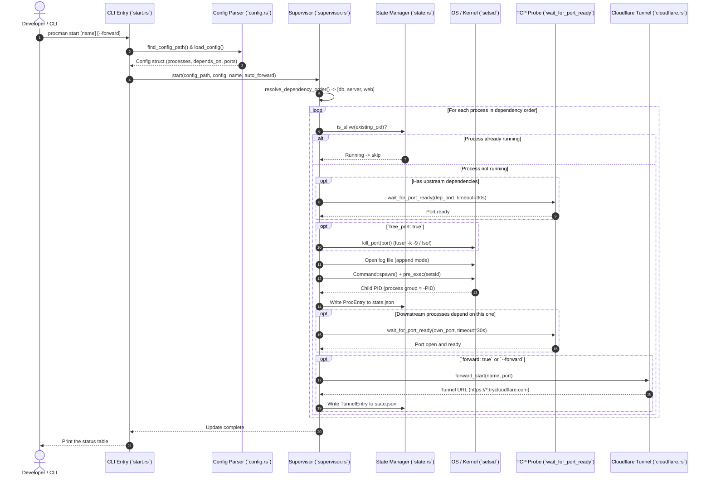
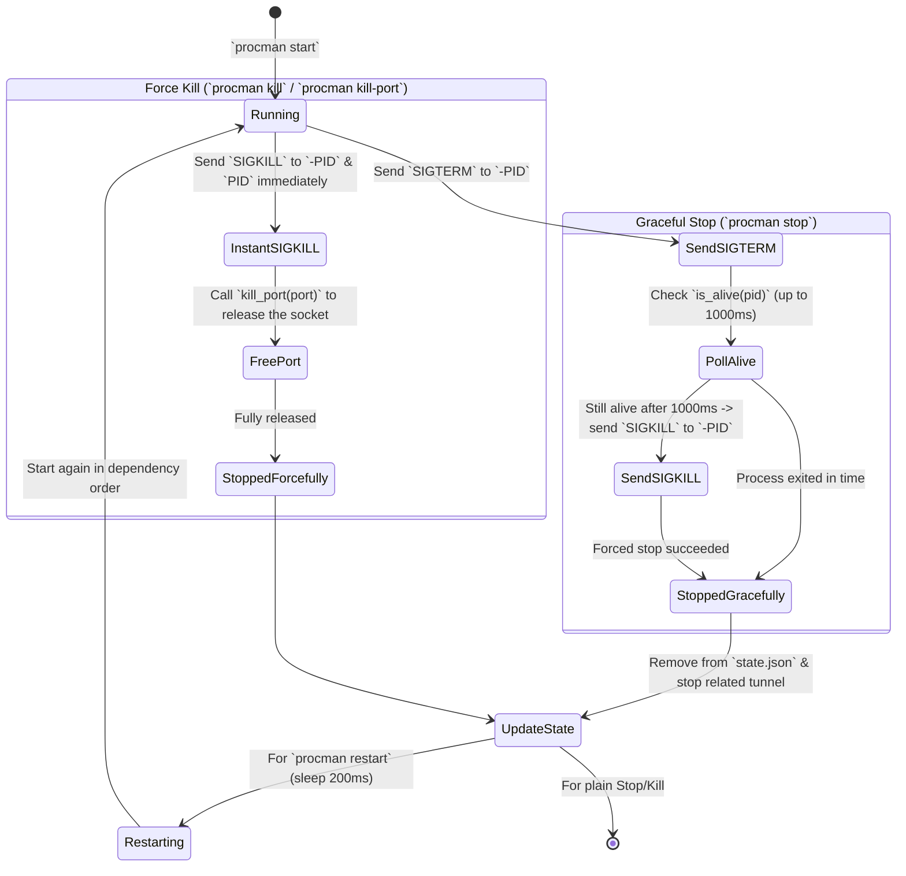
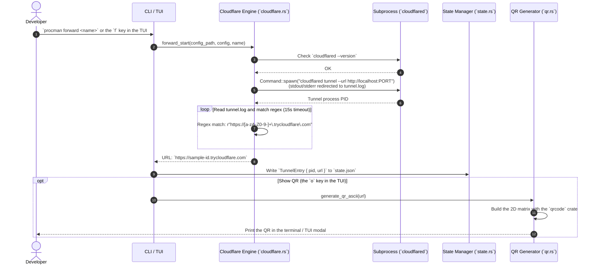
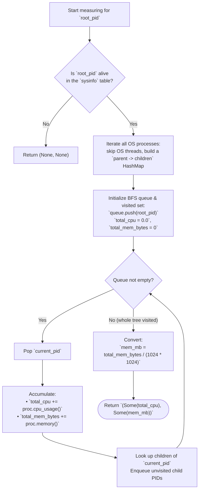
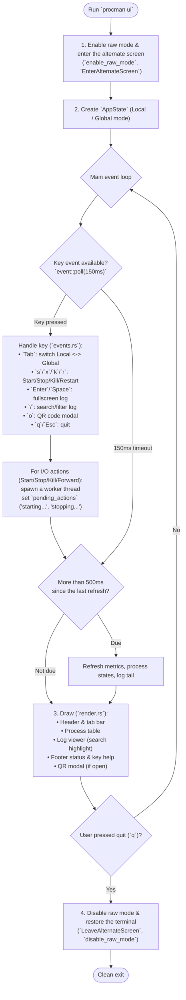
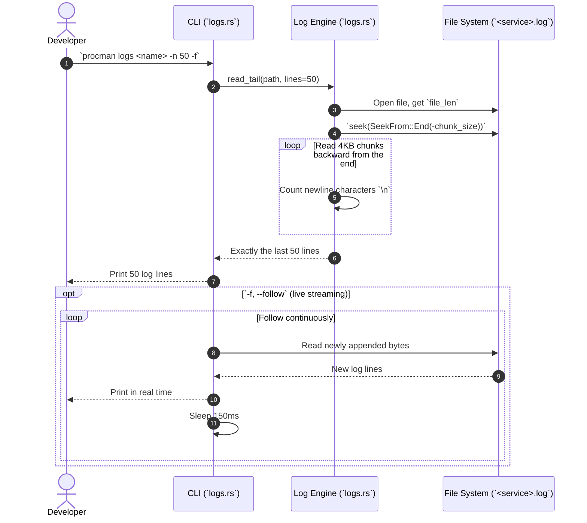

# 06. Process Flows & Feature Architecture

All flowcharts, sequence diagrams, and state machines for [`procman`](..), with an explanation of how each feature works.

---

## Table of Contents

1. [High-Level Architecture](#1-high-level-architecture)
2. [Project Isolation & XDG Paths](#2-project-isolation--xdg-paths)
3. [Start & Dependency Orchestration](#3-start--dependency-orchestration)
4. [Stop, Kill & Restart](#4-stop-kill--restart)
5. [File Watching & Hot Reload (`procman watch`)](#5-file-watching--hot-reload-procman-watch)
6. [Cloudflare Quick Tunnel & Mobile QR (`forward` & `qr`)](#6-cloudflare-quick-tunnel--mobile-qr-forward--qr)
7. [Real-Time CPU% & RAM Metrics](#7-real-time-cpu--ram-metrics)
8. [Global Registry & `procman ps`](#8-global-registry--procman-ps)
9. [TUI Dashboard Architecture & Loop (`procman ui`)](#9-tui-dashboard-architecture--loop-procman-ui)
10. [Log Reading & Streaming (`procman logs`)](#10-log-reading--streaming-procman-logs)
11. [Update & Uninstall](#11-update--uninstall)
12. [AI Agent Skill Distribution (`procman skill`)](#12-ai-agent-skill-distribution-procman-skill)
13. [Feature, CLI & TUI Key Matrix](#13-feature-cli--tui-key-matrix)

---

## 1. High-Level Architecture

`procman` is **daemonless**. Each child process gets its own session ID (`setsid`) and process group (`-PID`), so it runs independently and uses no system RAM when the TUI is closed.



---

## 2. Project Isolation & XDG Paths

To avoid state collisions between projects with the same directory or process names, `procman` uses the **XDG Base Directory** standard plus a **SHA-1** hash of the canonicalized absolute path:



---

## 3. Start & Dependency Orchestration

[`procman start`](../src/cli/commands/start.rs) resolves the dependency graph (`depends_on`), probes TCP ports for readiness, clears conflicting ports (`free_port`), and detaches the session (`setsid`).

### 3.1. Topological Sort & Cycle Detection



### 3.2. Full Start Sequence



---

## 4. Stop, Kill & Restart

`procman` never leaves orphan or zombie processes, because signals go to the whole **process group (`-PID`)**.



---

## 5. File Watching & Hot Reload (`procman watch`)

[`procman watch`](../src/cli/commands/watch.rs) uses [`watcher.rs`](../src/engine/watcher.rs) and the `notify` crate to detect source changes in real time, with noise filtering and a **350ms debounce**.

```mermaid
flowchart TD
    StartWatch(["Run `procman watch [name]`"]) --> LoadWatchCfg["Read `watch` & `watch_ignore` from YAML"]
    LoadWatchCfg --> RegisterNotify["Register directories with `RecommendedWatcher`<br/>(recursive mode)"]

    RegisterNotify --> EventLoop{"File event loop<br/>(Create / Modify / Remove)"}

    EventLoop --> ReceiveEvent["Receive event from the mpsc channel"]
    ReceiveEvent --> FilterNoise{"`should_ignore_path`:<br/>• Temp files (`.tmp`, `~`, `.log`)<br/>• Defaults: `.git`, `target`, `node_modules`, `dist`...<br/>• Custom: `watch_ignore`"}

    FilterNoise -- "Noise" --> EventLoop
    FilterNoise -- "Valid source file" --> CheckDebounce{"`now - last_restart >= 350ms`?"}

    CheckDebounce -- "Not yet (burst of writes)" --> EventLoop
    CheckDebounce -- "Yes (burst finished)" --> TriggerRestart["Set `last_restart = now`<br/>Print 'File change detected: path'"]

    TriggerRestart --> ExecRestart["Call `supervisor::restart()` for the service"]
    ExecRestart --> EventLoop
```

---

## 6. Cloudflare Quick Tunnel & Mobile QR (`forward` & `qr`)

`procman` can expose a local port (`localhost:PORT`) to the Internet through a **Cloudflare Quick Tunnel** (no account needed) and print a QR code in the terminal for phone scanning.



---

## 7. Real-Time CPU% & RAM Metrics

Unlike tools that measure only the parent PID, [`metrics.rs`](../src/engine/metrics.rs) measures the **entire process tree** (e.g. Node.js workers, Python multiprocessing children, Next.js build workers).



---

## 8. Global Registry & `procman ps`

`procman` keeps a central [`registry.json`](../src/engine/registry.rs) of every project it has worked with. [`procman ps`](../src/cli/commands/status.rs) and the **Global TUI** manage services across the whole machine.

```mermaid
flowchart TD
    subgraph Trigger_Auto_Register ["Auto-Registration"]
        AnyCommand["Any command run in a project<br/>(`start`, `stop`, `status`, `ui`...)"] --> ReadReg["Read `~/.local/state/procman/registry.json`"]
        ReadReg --> CheckReg{"Project already registered?"}
        CheckReg -- "No" --> AddReg["Add `ProjectEntry { key, dir, config_path, last_active }`"]
        CheckReg -- "Yes" --> UpdateActive["Set `last_active = Utc::now()`"]
        AddReg --> SaveReg["Save `registry.json`"]
        UpdateActive --> SaveReg
    end

    subgraph Global_Scanning ["System-Wide Scan (`procman ps` / `procman ui --all`)"]
        RunPS["`procman ps` or switching to the Global TUI tab"] --> ScanRegistry["1. Iterate every project in `registry.json`"]
        ScanRegistry --> LoadConfigEach["Read each project's config<br/>(both `● up` and `○ down` services)"]

        LoadConfigEach --> ScanOrphan["2. Scan `~/.local/state/procman/*`<br/>for orphan state outside the registry"]

        ScanOrphan --> MergeRows["Merge rows, measure CPU/RAM via `metrics.rs`"]
        MergeRows --> RenderGlobalTable["Show the machine-wide table:<br/>`PROJECT`, `SERVICE`, `STATUS`, `PID`, `CPU`, `MEM`, `PORT`, `TUNNEL`, `CWD`"]
    end
```

---

## 9. TUI Dashboard Architecture & Loop (`procman ui`)

The terminal UI ([`src/tui/`](../src/tui)) uses **`ratatui`** and **`crossterm`** with **immediate-mode rendering**, non-blocking event handling, and background workers so the UI never blocks.



---

## 10. Log Reading & Streaming (`procman logs`)

To show logs instantly without loading gigabyte-sized files into RAM, `procman` seeks backward from the end of the file in [`engine/logs.rs`](../src/engine/logs.rs).



---

## 11. Update & Uninstall

### 11.1. Automatic Update Check (24h Cache)

```mermaid
flowchart TD
    RunAny["Run any ordinary CLI command"] --> ReadCache["Read the cache at `~/.local/state/procman/update_cache.json`"]
    ReadCache --> CheckTTL{"Cache older than 24h<br/>or missing?"}

    CheckTTL -- "Fresh (< 24h)" --> UseCache["Use the cached version"]
    CheckTTL -- "Stale (> 24h)" --> SpawnCheckThread["Spawn a background thread (non-blocking):<br/>query the GitHub API for the latest release tag"]

    SpawnCheckThread --> SaveCache["Write the result to `update_cache.json` with a new timestamp"]
    SaveCache --> CompareVer{"`latest_version > current_version`?"}
    UseCache --> CompareVer

    CompareVer -- "Newer version" --> ShowBanner["Show a subtle banner after the command:<br/>`💡 A new version of procman is available: vX.Y.Z -> vA.B.C`<br/>`   Run 'procman upgrade' to update automatically.`"]
    CompareVer -- "Up to date" --> NoBanner["Show nothing; CLI is not slowed"]
```

### 11.2. `procman upgrade` & `procman uninstall`

```mermaid
flowchart LR
    subgraph UpgradeFlow ["`procman upgrade`"]
        UpStart(["`procman upgrade`"]) --> FetchRelease["Check GitHub for a new release"]
        FetchRelease --> PromptUp{"Confirm [y/N]<br/>(skipped with `-y`)"}
        PromptUp -- "Yes" --> CargoOrCurl["Prefer `cargo install --git ... --force`<br/>or download a pre-built binary via `install.sh`"]
        CargoOrCurl --> UpDone(["Upgrade complete"])
    end

    subgraph UninstallFlow ["`procman uninstall`"]
        UnStart(["`procman uninstall`"]) --> PromptUn{"Confirm cleanup [y/N]"}
        PromptUn -- "Yes" --> StopAll["Find and stop (`SIGKILL`) all running processes"]
        StopAll --> RemoveBin["Remove the `procman` binary from `$PATH` / `~/.cargo/bin`"]
        RemoveBin --> CheckPurge{"`--purge` set?"}
        CheckPurge -- "Yes" --> DeleteData["Delete data/state directories:<br/>`~/.local/state/procman`<br/>`~/.local/share/procman`"]
        CheckPurge -- "No" --> UnDone(["Uninstall complete"])
        DeleteData --> UnDone
    end
```

---

## 12. AI Agent Skill Distribution (`procman skill`)

So that AI coding assistants (**Antigravity**, **Cursor**, **Claude Code**, **Windsurf**, **Codex**) can control a project's background processes, `procman` embeds the skill definition at compile time:

```mermaid
flowchart TD
    CompileTime["Rust build (`cargo build`)"] --> EmbedMacro["`include_str!('../../../skills/procman/SKILL.md')`<br/>embeds the Markdown in the binary"]

    EmbedMacro --> BinaryReady["Self-contained `procman` binary<br/>(no Internet needed to install the skill)"]

    BinaryReady --> RunSkillCmd["User runs: `procman skill [dir]`"]
    RunSkillCmd --> DetectDir["Resolve the target directory (default: `.agents/skills/procman`)"]

    DetectDir --> CheckExisting{"`SKILL.md` already exists?"}
    CheckExisting -- "Yes" --> CheckMatch{"Content identical to<br/>the embedded copy?"}
    CheckMatch -- "Identical (up to date)" --> InformUpToDate["Print: `✨ procman skill is already up-to-date`"]
    CheckMatch -- "Different / `-f`" --> OverwriteFile["Overwrite with the new content"]

    CheckExisting -- "No" --> CreateParentDir["Create parent directories (`fs::create_dir_all`)"]
    CreateParentDir --> OverwriteFile

    OverwriteFile --> FinishSkill(["Print: `✅ Successfully installed procman skill to .agents/skills/procman/SKILL.md`"])
```

---

## 13. Feature, CLI & TUI Key Matrix

Mapping of **features** to **CLI commands**, **TUI keys**, **`procman.yaml` options**, and the **Rust source files** responsible:

| Feature | CLI command | TUI key (`procman ui`) | `procman.yaml` | Source |
| :--- | :--- | :--- | :--- | :--- |
| **Start processes** | `procman start [name] [-f/--forward]` | `s` | `cmd`, `cwd`, `env`, `port` | [`supervisor.rs`](../src/engine/supervisor.rs), [`start.rs`](../src/cli/commands/start.rs) |
| **POSIX graceful stop** | `procman stop [name]` | `x` | - | [`supervisor.rs`](../src/engine/supervisor.rs), [`stop.rs`](../src/cli/commands/stop.rs) |
| **Force kill & free port** | `procman kill [name]` | `k` | `free_port: true` | [`supervisor.rs`](../src/engine/supervisor.rs) |
| **Free a specific port** | MCP tool `procman_kill_port` | - | `free_port: true` | [`supervisor.rs`](../src/engine/supervisor.rs), [`mcp/`](../src/engine/mcp/mod.rs) |
| **Restart** | `procman restart [name] [-f/--forward]` | `r` | - | [`supervisor.rs`](../src/engine/supervisor.rs) |
| **Status & resources** | `procman status [name]` | Default view | - | [`status.rs`](../src/cli/commands/status.rs), [`metrics.rs`](../src/engine/metrics.rs) |
| **System-wide scan** | `procman ps` / `procman ls` | `Tab` (Global mode) | - | [`status.rs`](../src/cli/commands/status.rs), [`registry.rs`](../src/engine/registry.rs) |
| **Dependencies & readiness** | Automatic on `start` | - | `depends_on: [db, api]` | [`supervisor.rs`](../src/engine/supervisor.rs) |
| **Hot reload on file change** | `procman watch [name]` | - | `watch: true`, `watch_ignore` | [`watcher.rs`](../src/engine/watcher.rs), [`watch.rs`](../src/cli/commands/watch.rs) |
| **Open Cloudflare Quick Tunnel** | `procman forward <name>` | `f` | `forward: true` | [`cloudflare.rs`](../src/tunnels/cloudflare.rs) |
| **Close Cloudflare tunnel** | `procman unforward <name>` | `u` | - | [`cloudflare.rs`](../src/tunnels/cloudflare.rs) |
| **Mobile QR code** | - | `o` (modal) | - | [`qr.rs`](../src/tunnels/qr.rs) |
| **View & stream logs** | `procman logs <name> [-f] [-n]` | Log viewer pane | - | [`logs.rs`](../src/engine/logs.rs), [`logs.rs`](../src/cli/commands/logs.rs) |
| **Search / filter logs** | - | `/` (search), `c` (clear) | - | [`events.rs`](../src/tui/events.rs), [`render.rs`](../src/tui/render.rs), [`logview.rs`](../src/tui/logview.rs) |
| **Fullscreen log** | - | `Enter` / `Space` | - | [`events.rs`](../src/tui/events.rs), [`render.rs`](../src/tui/render.rs) |
| **Remove project from registry** | - | `d` / `Delete` | - | [`registry.rs`](../src/engine/registry.rs), [`actions.rs`](../src/tui/actions.rs) |
| **Update check & self-upgrade** | `procman upgrade` | - | - | [`updater.rs`](../src/cli/commands/updater.rs), [`telemetry.rs`](../src/engine/telemetry.rs) |
| **Clean uninstall** | `procman uninstall [-y] [--purge]` | - | - | [`uninstaller.rs`](../src/cli/commands/uninstaller.rs) |
| **Install AI agent skill** | `procman skill [dir] [-f]` | - | - | [`skill.rs`](../src/cli/commands/skill.rs) |
| **Diagnose & fix** | `procman doctor [name] [-s] [--ai] [-f]` | - | - | [`doctor.rs`](../src/cli/commands/doctor.rs), [`doctor/`](../src/engine/doctor/mod.rs) |
| **Generate config** | `procman init [dir] [--ai] [-y]` | - | - | [`init.rs`](../src/cli/commands/init.rs), [`init/`](../src/engine/init/mod.rs) |
| **MCP server for AI agents** | `procman mcp [-d <dir>]` | - | - | [`mcp.rs`](../src/cli/commands/mcp.rs), [`mcp/`](../src/engine/mcp/mod.rs) |
